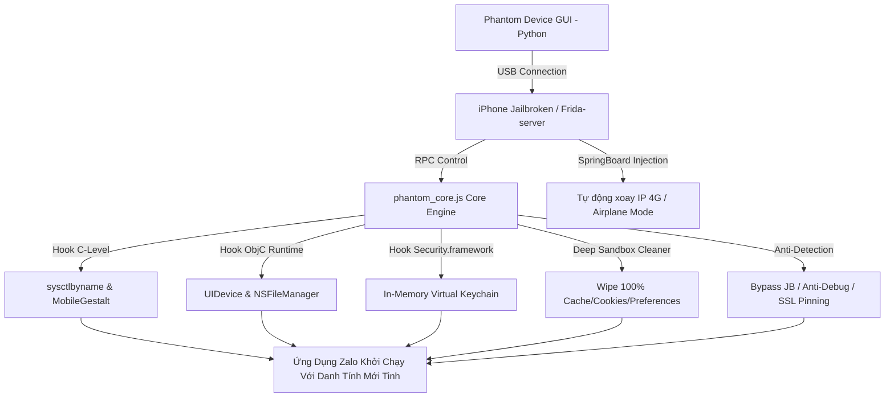

# 📱 PHANTOM DEVICE PRO - ZALO iOS v4.0
### 🚀 Advanced Device Fingerprint Spoofing & Deep Sandbox Isolation Engine

<div align="center">


-0068FF?style=for-the-badge&logo=zalo)


</div>

---

## 👑 THÔNG TIN TÁC GIẢ & HỖ TRỢ KỸ THUẬT

> **Tác giả:** `huydz2009-truongduchuy`  
> **Kênh Telegram chính thức:** [t.me/huydz2009](https://t.me/huydz2009) (`@huydz2009`)  
> **Dự án:** Phantom Device Pro - Bộ công cụ Fake Thông tin phần cứng & Cách ly dữ liệu chuyên sâu cho Zalo iOS.  
> **Hỗ trợ:** Cấu hình Bypass Checkpoint, fix lỗi OTP, tối ưu hóa quy trình Reg & Nuôi Nick Zalo số lượng lớn.

---

## 🌟 TỔNG QUAN DỰ ÁN

**Phantom Device Pro v4.0** là giải pháp đỉnh cao trong lĩnh vực can thiệp thời gian thực (Runtime Instrumentation) trên hệ điều hành iOS, được thiết kế chuyên biệt cho ứng dụng **Zalo (com.zing.zalo)**. 

Bằng cách kết hợp sức mạnh của **Frida Dynamic Binary Instrumentation**, can thiệp sâu vào tầng **C-Level Kernel/POSIX**, **Objective-C Runtime**, cùng kiến trúc **In-Memory Virtual Keychain**, công cụ biến một chiếc iPhone vật lý thành hàng triệu thiết bị Apple hoàn toàn mới, loại bỏ hoàn toàn khả năng bị Zalo quét vân tay thiết bị (Fingerprint Linkage) hay khóa tài khoản dây chuyền.



---

## ⚡ CÁC CƠ CHẾ KỸ THUẬT "XỊN SÒ" ĐỘC QUYỀN

### 1. 🧬 Dynamic Apple Identity Database & RPC Profile Generator
- **Cơ sở dữ liệu thực 100% Apple**: Tích hợp danh mục thông số chuẩn xác từ **iPhone 11 đến iPhone 15 Pro Max**, bao gồm Model Name, Machine Code (`iPhone12,1` ➔ `iPhone16,2`), phiên bản iOS thực tế (iOS 16.5 ➔ 18.0) và OS Build chuẩn (`20F66`, `21B91`, `22A3354`).
- **Sinh danh tính hoàn chỉnh**: Tự động sinh IDFV (UUIDv4), UDID cấu trúc chuẩn Apple (`00008101-XXXXXXXXXXXXXXXX`), Serial Number (`F` + 11 ký tự Base36), Tên người dùng ngẫu nhiên tự nhiên (`iPhone của Huy`, `iPhone của Nam`...), MAC Address ngẫu nhiên cho cả WiFi và Bluetooth.
- **Nạp Profile nóng (Live RPC)**: Nạp thông số trực tiếp từ Python GUI qua Frida RPC (`setProfile`, `randomizeProfile`) vào bộ nhớ app trong mili-giây trước khi tiến trình Zalo được `resume`.

---

### 2. ⚙️ C-Level Hardware Spoofing (sysctlbyname & MobileGestalt)
Hầu hết các thư viện bảo mật cao cấp hoặc SDK chống gian lận của Zalo đều gọi thẳng vào tầng Native C-Level nhằm tránh bị hook tầng Objective-C. Phantom Core v4.0 xử lý triệt để:
- **Hook `sysctlbyname`**:
  - Ghi đè tham số `hw.machine` và `hw.model` trả về mã phần cứng giả lập (vd: `iPhone14,2`).
  - Ghi đè `kern.osversion` trả về OS Build tương ứng.
  - Cập nhật độ dài chuỗi bộ nhớ (`oldlenp`) chuẩn xác để các hàm C native không bị buffer overflow hay crash.
- **Hook `MobileGestalt (MGCopyAnswer)`**:
  - Can thiệp trực tiếp vào `libMobileGestalt.dylib`.
  - Thay thế kết quả các khóa bảo mật phần cứng: `ProductType`, `UserAssignedDeviceName`, `UniqueDeviceID`, `SerialNumber`, `WifiAddress`, `BluetoothAddress`.

---

### 3. 🎯 Objective-C Runtime Hooking (UIDevice Caching)
- Can thiệp an toàn và triệt để vào lớp `UIDevice`:
  - `-[UIDevice identifierForVendor]` ➔ Trả về IDFV giả lập mới.
  - `-[UIDevice name]` ➔ Trả về tên thiết bị mới.
  - `-[UIDevice systemVersion]` & `-[UIDevice systemName]` ➔ Phiên bản iOS giả lập.
  - `-[UIDevice model]` & `-[UIDevice localizedModel]`.
- **Heap Cache Optimization**: Lưu sẵn các đối tượng `NSString`, `NSUUID` trên heap memory của phiên làm việc. Khi Zalo truy vấn liên tục trong vòng lặp rendering, hàm hook phản hồi tức thì với độ trễ xấp xỉ 0ms, không gây lag hay tràn bộ nhớ.

---

### 4. 🔐 In-Memory Virtual Keychain Store (Bảo Vệ Keychain Ảo Trong RAM)
> **Vấn đề cốt tử:** Nếu hook Keychain trả về `null` hoặc lỗi bừa bãi, iOS sẽ bị sập tầng mạng TLS do mất chứng chỉ Apple CA, hoặc Zalo sẽ crash khi lưu session token. Nếu không can thiệp, Zalo sẽ ghi nhớ UDID/Token vào Keychain và nhận ra thiết bị cũ dù đã gỡ app cài lại!

- **Giải pháp của Phantom Core**:
  - Hook hai hàm cốt lõi `SecItemCopyMatching` và `SecItemAdd` trong `Security.framework`.
  - **Phân loại thông minh (Smart Passthrough)**: Cho phép tất cả các truy vấn chứng chỉ hệ thống (`cert`, `idnt`, `keys`) đi thẳng vào Apple Keychain thật, bảo đảm kết nối SSL/TLS, xác thực APNs Push của Apple luôn hoạt động 100%.
  - **Virtual RAM Storage**: Riêng các token tài khoản, mã định danh do Zalo lưu, engine chuyển hướng lưu vào một `Map()` trong bộ nhớ RAM tạm thời.
  - **Tự động cô lập**: Khi tắt phiên hoặc tạo Profile mới, RAM được xóa sạch. Zalo tìm kiếm dữ liệu cũ sẽ chỉ nhận được `errSecItemNotFound (-25300)`. Zalo hoàn toàn tin rằng đây là một chiếc máy mới tinh vừa xuất xưởng!

---

### 5. ✈️ Tự Động Xoay IP 4G Bằng SpringBoard RPC (Airplane Mode Automation)
- Can thiệp trực tiếp vào tiến trình hệ thống `SpringBoard` của iPhone qua cổng USB:
  - Gọi class `SBAirplaneModeController` hoặc `RadiosPreferences` để tự động kích hoạt **Bật Chế độ máy bay** ➔ Giữ trong 4-5 giây ➔ **Tắt Chế độ máy bay**.
  - Buộc trạm BTS của nhà mạng viễn thông (Viettel, Vina, Mobi) ngắt kết nối và cấp phát ngay một địa chỉ IP Public mới tinh (IP di động sạch).
  - Tích hợp cơ chế **Smart Fallback**: Nếu phiên bản iOS hạn chế quyền truy cập SpringBoard, Tool hiển thị hướng dẫn gạt Control Center thủ công với đồng hồ đếm ngược trực quan.

---

### 6. 🧹 Deep Sandbox Wipe (Dọn Sạch 100% Dữ Liệu Rác & Cookie)
Trước khi khởi chạy Profile mới, engine thực hiện quy trình tẩy rửa cấp độ sâu:
- Quét và xóa sạch các thư mục trong Sandbox ứng dụng Zalo:
  - `Documents/` (chứa toàn bộ cơ sở dữ liệu SQLite, tin nhắn, hình ảnh lưu trữ)
  - `Library/Caches/`
  - `Library/Application Support/`
  - `Library/Preferences/` (các file plist cấu hình)
  - `tmp/`
- Gọi `removePersistentDomainForName:` trên `NSUserDefaults` để hủy toàn bộ key định danh ứng dụng.
- Quét và xóa toàn bộ cookies trong `NSHTTPCookieStorage`.
- Xóa sạch Map lưu trữ Virtual Keychain trong RAM.

---

### 7. 🛡️ Toàn Diện Bypass Jailbreak & Anti-Debug
- **POSIX & Objective-C File Hiding**:
  - Hook `stat`, `lstat`, `access` ở tầng C.
  - Hook `fileExistsAtPath:` và `fileExistsAtPath:isDirectory:` của `NSFileManager`.
  - Che giấu toàn bộ hơn 15 đường dẫn Jailbreak phổ biến: `/Applications/Cydia.app`, `/Applications/Sileo.app`, `/Library/MobileSubstrate`, `/usr/bin/frida-server`, `/etc/apt`...
- **Chặn URL Scheme Detection**: Hook `UIApplication canOpenURL:` trả về `NO` với các scheme `cydia:`, `sileo:`, `zbra:`.
- **Anti-Debug Defense**:
  - Triệt tiêu lệnh gọi `ptrace(PT_DENY_ATTACH, ...)`.
  - **POSIX Thread Masking**: Hook `pthread_setname_np`, tự động đổi tên các thread chứa `frida`, `gum-js`, `agent` thành tên chuẩn của hệ thống Apple: `com.apple.root.default-priority`.

---

### 8. 🌐 Bypass SSL Pinning & Giấu Dữ Liệu Mạng Cục Bộ
- **Vượt SSL Pinning**:
  - Hook `SecTrustEvaluateWithError` và `SecTrustEvaluate` luôn trả về trạng thái chứng chỉ hợp lệ (`kSecTrustResultProceed`).
  - Hook delegate `NSURLSession URLSession:didReceiveChallenge:completionHandler:`.
- **Ẩn BSSID/SSID WiFi**:
  - Hook `CNCopyCurrentNetworkInfo` trong `SystemConfiguration.framework` trả về `NULL`.
  - Ngăn chặn Zalo định vị vị trí địa lý hoặc quét fingerprint qua danh sách các bộ phát WiFi xung quanh phòng làm việc của bạn.

---

### 9. 🖥️ Giao Diện Hiện Đại & Chức Năng "Check Độ An Toàn" (Safety Score)
- Xây dựng bằng `CustomTkinter` với giao diện Dark Mode tương lai mang đậm phong cách Cyberpunk/Modern DevTools.
- **Tính năng Safety Check (Thang điểm 100)**:
  - `+20đ`: Kiểm tra tính toàn vẹn của tệp lõi `phantom_core.js`.
  - `+25đ`: Kiểm tra kết nối USB thực với iPhone và trạng thái daemon `frida-server`.
  - `+20đ`: Kiểm tra gói ứng dụng Zalo (`com.zing.zalo`) trên máy mục tiêu.
  - `+20đ`: Kiểm tra quyền can thiệp tiến trình hệ thống `SpringBoard`.
  - `+15đ`: Kiểm tra kết nối Internet và lấy IP Public hiện tại.
  - Đánh giá xếp loại: **Xuất sắc (>80đ)**, **Cảnh báo (50-80đ)**, **Chưa đạt (<50đ)**.

---

## 📋 SO SÁNH PHANTOM DEVICE PRO V4.0 VỚI CÁC TOOL THƯỜNG

| Tính Năng / Cơ Chế | Tool Đổi Thông Tin Thường | Phantom Device Pro v4.0 |
| :--- | :---: | :---: |
| **Độ sâu can thiệp** | Chỉ hook vài hàm ObjC cơ bản | Can thiệp đa tầng: C-Level (`sysctl`, `Gestalt`) + ObjC Runtime |
| **Bảo vệ Keychain** | Hook `null` (gây lỗi kết nối/crash) | **Virtual In-Memory Keychain** (cô lập token, giữ nguyên SSL) |
| **Xoay IP 4G** | Phải gạt tay hoặc dùng proxy lag | **Tự động qua SpringBoard RPC** bật/tắt Airplane Mode |
| **Làm sạch Sandbox** | Gỡ app tải lại hoặc xóa thủ công | **Wipe sạch 100% Documents, Caches, Preferences, Cookies** |
| **Bảo vệ định vị WiFi** | Không có (bị Zalo phát hiện vị trí) | **Hook `CNCopyCurrentNetworkInfo` giấu triệt để BSSID/SSID** |
| **Chống Anti-Debug** | Bị phát hiện tên luồng Frida | **Masking tên luồng POSIX & vô hiệu hóa `ptrace`** |
| **Kiểm tra môi trường** | Không có | **Safety Score 100 điểm tự động chẩn đoán lỗi** |

---

## 🚀 HƯỚNG DẪN CÀI ĐẶT & SETUP TOOL TỪ A - Z

### 1. Chuẩn Bị Thiết Bị iPhone (Target Device)
1. **Jailbreak iPhone**:
   - Tool tương thích với mọi bản Jailbreak phổ biến trên iOS 15 - 18:
     - **Dopamine** (Khuyên dùng nhất trên iOS 15.0 - 16.6.1): Cực kỳ mượt, không bị văng app, rootless an toàn.
     - **Palera1n** (Dành cho các dòng máy chip A8 - A11 hỗ trợ iOS 15.0 - 18.x).
     - **unc0ver** / **Taurine** (Dành cho các dòng iOS 14.x trở xuống).
2. **Cài Đặt Frida-Server Trên iPhone**:
   - Mở trình quản lý gói tweak: **Sileo**, **Zebra** hoặc **Cydia**.
   - Thêm nguồn (Sources / Repositories):
     ```
     https://build.frida.re
     ```
   - Tìm kiếm gói tên `Frida` và bấm **Cài đặt (Install)**.
   - Sau khi cài xong, `frida-server` sẽ tự động kích hoạt làm daemon chạy ngầm trên iPhone.
3. **Cài Đặt Zalo & Mạng 4G**:
   - Tải bản Zalo chính thức mới nhất từ Apple App Store (`com.zing.zalo`).
   - Lắp SIM 4G/5G trực tiếp vào iPhone (Viettel, VinaPhone, MobiFone).
   - **TẮT HẲN KẾT NỐI WIFI**, chỉ bật **Dữ liệu di động (4G/5G)**. Dải IP mạng di động của nhà mạng là IP sạch có độ tin cậy cao nhất đối với hệ thống chống gian lận của Zalo.

---

### 2. Chuẩn Bị Môi Trường Máy Tính (Windows PC)
1. **Cài đặt Python (3.9 - 3.12)**:
   - Tải từ trang chủ [python.org](https://www.python.org).
   - ⚠️ **LƯU Ý QUAN TRỌNG:** Trong bước cài đặt đầu tiên, **bắt buộc tích chọn vào ô `"Add Python to PATH"`**.
2. **Cài đặt Driver Apple (iTunes)**:
   - Cài đặt iTunes chính thức từ Apple (khuyên dùng bản installer trực tiếp `.exe`, không dùng bản rút gọn từ Microsoft Store) để Windows nhận diện đầy đủ driver `Apple Mobile Device Support`.
3. **Cài đặt các thư viện cần thiết**:
   - Mở **Terminal**, **PowerShell** hoặc **Command Prompt (CMD)** và chạy lệnh:
     ```bash
     pip install customtkinter frida
     ```
   - *(Tool cũng tích hợp mã tự động phát hiện và cài đặt thư viện thiếu nếu bạn chạy trực tiếp).*

---

### 3. Kết Nối & Kiểm Tra Tín Hiệu Thiết Bị
1. Cắm cáp kết nối iPhone với máy tính qua cổng USB (khuyên dùng cổng USB 3.0 trực tiếp bo mạch chủ máy tính).
2. Mở khóa màn hình iPhone ➔ Khi xuất hiện hộp thoại: Bấm chọn **"Tin cậy máy tính này" (Trust This Computer)**.
3. Nhập mật mã mở khóa màn hình iPhone để cấp quyền kết nối USB hoàn chỉnh.
4. Mở PowerShell hoặc CMD gõ lệnh sau để kiểm tra:
   ```bash
   frida-ps -U
   ```
   - Nếu màn hình trả về danh sách các tiến trình đang chạy trên iPhone, kết nối USB và daemon Frida đã **HOÀN TOÀN SẴN SÀNG**!

---

### 4. Khởi Chạy Công Cụ & Chẩn Đoán Độ An Toàn
1. Khởi chạy file Python chính:
   ```bash
   python PhantomDevice_Tool.py
   ```
2. Trên góc trên bên phải của giao diện Tool, bấm nút **`[🔍 Check Độ An Toàn]`**:
   - Hệ thống tiến hành chẩn đoán 5 tiêu chí:
     - `[✓] File lõi phantom_core.js (+20đ)`
     - `[✓] Kết nối USB với iPhone & Frida Daemon (+25đ)`
     - `[✓] Gói Zalo com.zing.zalo (+20đ)`
     - `[✓] Quyền can thiệp SpringBoard để xoay IP (+20đ)`
     - `[✓] Kết nối Internet máy tính (+15đ)`
   - Khi điểm an toàn đạt **>= 80/100đ**, môi trường đã đạt chuẩn xuất sắc để bắt đầu quy trình reg nick!

---

### 5. Xử Lý Các Sự Cố Setup Thường Gặp (Troubleshooting)
> [!WARNING]
> **Lỗi "Không tìm thấy iPhone":**
> - Rút cáp cắm lại vào cổng USB khác, mở khóa màn hình iPhone và bấm "Tin cậy" (Trust).
> - Kiểm tra xem dịch vụ `Apple Mobile Device Service` trong Windows Services (`services.msc`) có đang ở trạng thái `Running` hay không.

> [!WARNING]
> **Lỗi "frida.ServerNotRunningError":**
> - Mở Sileo trên iPhone kiểm tra xem package `Frida` đã được cài đặt chưa.
> - Khởi động lại iPhone và kích hoạt lại Jailbreak (Re-jailbreak) nếu máy bị mất trạng thái jailbreak sau khi khởi động lại.

> [!TIP]
> **Lỗi "SpringBoard không phản hồi tự động":**
> - Một số phiên bản iOS có phân quyền bảo mật chặt chẽ ngăn Frida can thiệp SpringBoard. Khi đó, tool sẽ hiển thị cảnh báo và chuyển sang chế độ **Fallback thông minh**: Đồng hồ đếm ngược trực quan sẽ hiện lên trên log, bạn chỉ cần vuốt thanh Control Center trên iPhone và gạt tay Bật/Tắt chế độ máy bay theo hướng dẫn!

---

### 6. Quy Trình 4 Bước Reg Nick Zalo Bất Bại
1. **Bước 1**: Bấm `[🎲 Sinh Profile Mới]` để tạo một đặc danh phần cứng mới toanh (iPhone 11 ➔ 15 Pro Max).
2. **Bước 2**: Giữ tích chọn cả 2 tính năng an toàn:
   - `[✓] Tự động xoay IP 4G (Bật/Tắt máy bay)`
   - `[✓] Tự động Wipe Sandbox`
3. **Bước 3**: Bấm `[🚀 KHỞI ĐỘNG BYPASS & CHẠY ZALO]`.
   - Tool tự xoay IP ➔ Dọn dẹp dữ liệu cũ ➔ Nạp Profile mới ➔ Khởi động Zalo.
   - Nhập SĐT, nhận mã OTP và hoàn tất đăng ký nick.
4. **Bước 4**: Sau khi đăng ký xong:
   - Bấm `[🛑 DỪNG TIẾN TRÌNH]`.
   - Lặp lại từ **Bước 1** cho nick tiếp theo!

---

## 💡 KINH NGHIỆM NUÔI NICK TRÁNH CHECKPOINT (24H - 48H)
1. **Cập nhật hồ sơ ngay**: Đặt tên người dùng tự nhiên, ảnh đại diện rõ ràng, cập nhật ngày tháng năm sinh và giới tính.
2. **Bật bảo mật 2 lớp**: Thiết lập mật khẩu hoặc mã khóa bảo vệ tài khoản trong cài đặt Zalo.
3. **Tạo tương tác thật ban đầu**: Kết bạn với 1-2 tài khoản Zalo uy tín khác hoặc nhắn 1 vài tin nhắn trò chuyện thông thường.
4. **Không spam**: Tuyệt đối không rải link hàng loạt, không tham gia ồ ạt hàng chục nhóm hay gửi kết bạn liên tục trong 24 giờ đầu tiên. Hãy để tài khoản ngâm (online) ổn định trước khi đưa vào luồng tự động hóa.

---

## 📞 LIÊN HỆ & BẢN QUYỀN

- **Tác giả (Author):** `huydz2009-truongduchuy`
- **Telegram liên hệ trực tiếp:** [https://t.me/huydz2009](https://t.me/huydz2009)
- Bản quyền thuộc về tác giả. Dự án được phát triển nhằm mục đích nghiên cứu bảo mật và tối ưu hóa quy trình làm việc tự động trên iOS.
